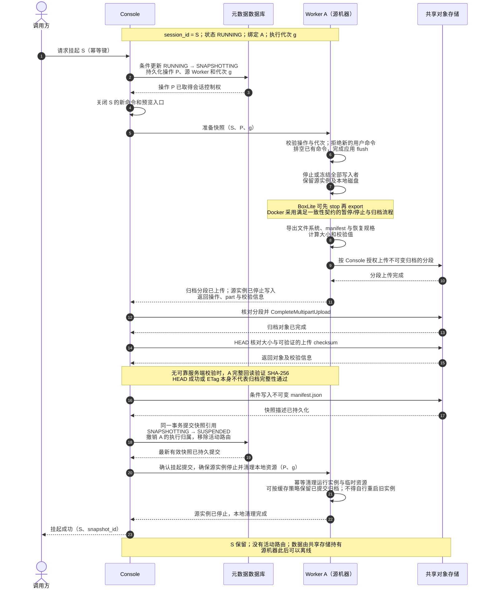
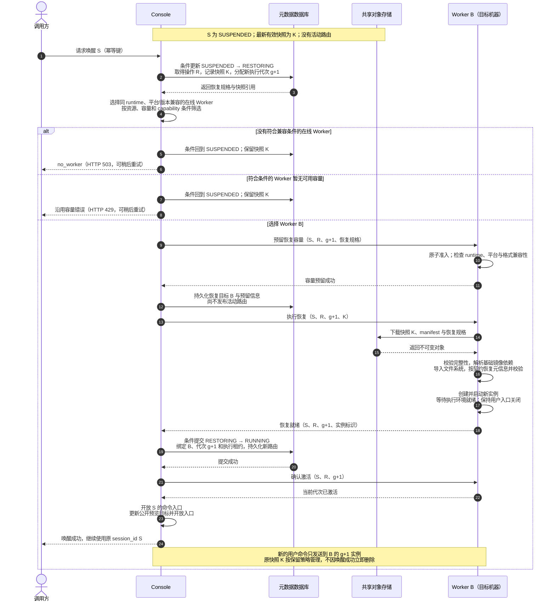
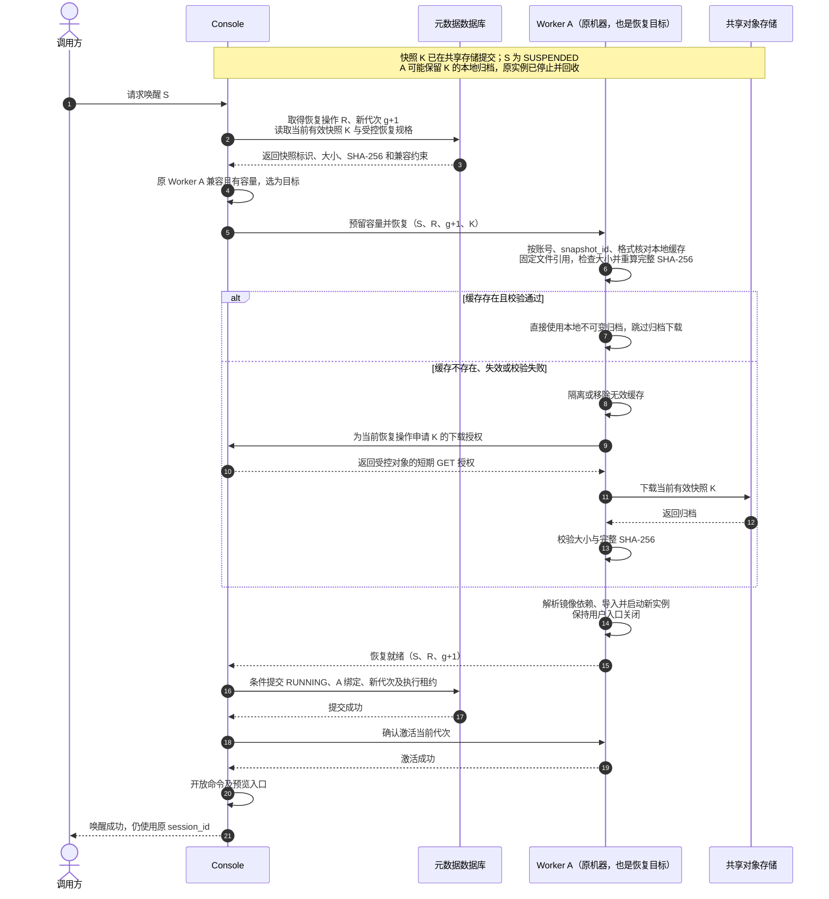
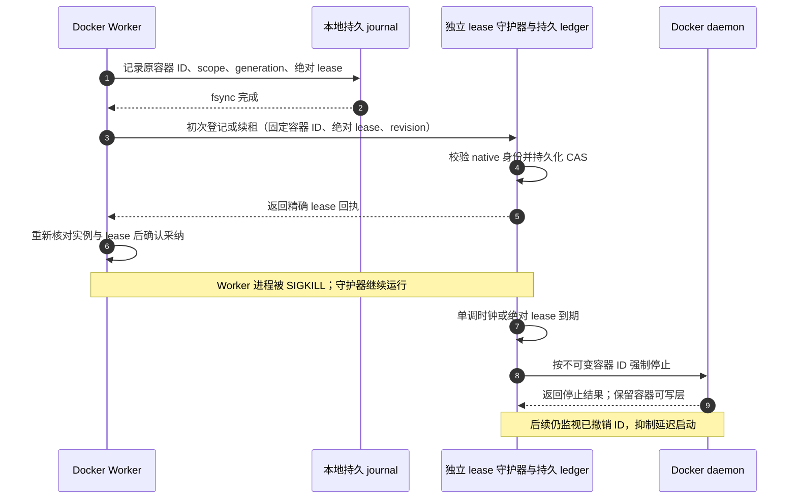
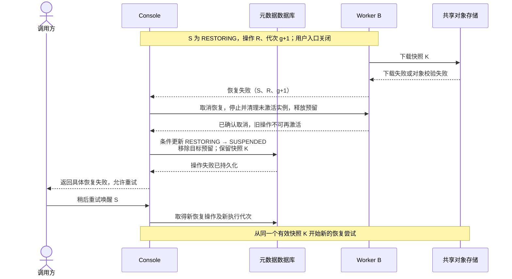

# 沙箱会话持久化与跨 Worker 唤醒流程

## 范围

本文定义第一阶段的目标流程：一个正在 Worker A 上运行的沙箱会话，生成文件系统快照并停止运行，随后在另一台机器的 Worker B 上启动。A 与 B 使用相同 runtime，OS/CPU 架构、归档格式及版本满足恢复兼容条件。本文为首期完整设计；当前实现与剩余验收边界见 [Console 配置](../../console/docs/config-file.md#sandbox-persistence)及 [Docker 生命周期说明](../../worker/worker-docker/docs/sandbox-snapshot-controller.md)，不能据此认定跨机器验收已完成。

持久化范围为约定的根文件系统数据及恢复规格。唤醒保留原 `session_id`，创建新的执行实例；进程、内存、打开的文件句柄和网络连接不恢复。临时挂载及 volume 的保留策略单独定义。当前可行性和已知限制见[持久化就绪评估](../experiments/filesystem-portability/PERSISTENCE_READINESS.zh-CN.md)。

共享对象存储的必需 S3 能力、传输/校验时序、性能预算及 API/配置变更，见[对象存储与接口设计](sandbox-session-persistence-storage-api.zh-CN.md)。接口当前行为以[统一 API](../API.zh-CN.md#75-挂起--唤醒-session)为准。

## 参与方与稳定数据

| 参与方 | 职责 |
| --- | --- |
| 调用方 | 请求挂起或唤醒，使用稳定的 `session_id` |
| Console | 管理会话状态、操作幂等、调度、执行代次与路由发布 |
| 元数据数据库 | 持久化会话、恢复规格、有效快照引用、操作状态和运行实例归属 |
| Worker A | 排空命令、停止文件系统写入、生成归档并清理源实例 |
| 共享对象存储 | S3 兼容持久存储；支持 multipart、HEAD/GET、完整性校验及删除，保存独立于源 Worker 的不可变归档与 manifest |
| Worker B | 预留容量、下载与校验归档、恢复实例、报告就绪 |

持久化会话至少记录以下信息：

- 账号归属、`session_id`、生命周期状态及数据保留期。
- `runtime`、平台、基础镜像的平台 manifest digest、归档格式版本与兼容约束。
- 资源配置、执行用户、工作目录、环境变量、启动命令和挂载规格。
- 最新有效 `snapshot_id`、对象引用、大小、校验值及文件系统 manifest。
- 当前操作 ID、执行代次 `generation`，以及存在运行实例时的 Worker 绑定与执行租约。

`generation` 标识会话当前的执行所有权代次；`snapshot_id` 标识不可变的数据恢复点，两者用途不同。操作重试复用操作 ID；重新分配执行所有权时使用新代次。归档中的本机绝对路径必须转换为目标可解析的依赖，不能直接假定源 Worker 路径可达。

## 从运行到快照提交和停止

挂起开始后，Console 阻止新的用户执行和公开预览访问。Worker 排空已接受的命令，并处理沙箱内独立后台进程的写入；仅等待 `terminalExec` 完成不足以获得一致快照。文件系统归档开始前，实例必须进入停止写入的状态。

这里有两个不同的完成点：

1. **数据提交点**：归档已经上传并校验，数据库事务提交了有效快照引用。此后可以从共享存储恢复。
2. **资源回收完成点**：源实例已停止并释放本地资源。清理失败可重试，不应删除已提交快照或使源实例重新接受写入。

实例可能在快照提交前就停止运行，例如 BoxLite 的 stop/export 路径；但在快照提交前不得删除源实例的唯一有效本地数据。操作失败后，Console 必须根据实际后端状态决定继续上传、重试导出或重新启动源实例，不能直接把状态改回 RUNNING 并宣称原进程仍在运行。

## 从挂起到另一台机器恢复运行

挂起后解绑原 Worker，唤醒重新选择同 runtime 的兼容 Worker。下图以另一台机器上的 Worker B 为目标；生产调度也可以选择仍然符合条件的原机器。唤醒过程中，用户命令与公开预览入口保持关闭。

Worker 上报恢复就绪只表示实例可用，不表示它已获得用户执行权。数据库提交与激活确认完成后，Console 才对外开放入口。提交后 Console 重启或激活响应丢失时，应核对数据库中的 B、操作 R 和代次 g+1，幂等完成激活，而不是再创建第二个实例。

容量错误复用现有语义：没有兼容在线候选使用 `no_worker`；capability 并发容量不足使用 `no_capacity`；Worker 原子准入拒绝使用 `session_capacity_exceeded`。后两者映射 HTTP 429，不额外新增“持久化无可用 Worker”错误码。容量快照不是预留承诺，最终准入仍由目标 Worker 判断。

## 在原 Worker 上恢复：本地归档缓存路径

同节点与跨节点使用同一套挂起、调度、恢复及激活协议。共享存储上传、完整性校验与数据库提交仍是挂起成功的前提；原 Worker 可以把已提交的归档保留为本地缓存，不能把尚未上传的本地文件当作持久化成功。

调度先筛选同 runtime、平台/格式兼容且有容量的 Worker，再将匹配的本地缓存作为择优条件。原 Worker 不形成永久绑定；离线、满载或不兼容时仍可选择其他符合条件的 Worker，没有可用候选时沿用现有调度错误。缓存提示只影响排序，不能代替最终准入与恢复时的完整性核对。

本地缓存的最小规则：

- 只有与数据库当前快照引用相符的归档可恢复；相同 session ID、文件名或原容器 ID 不足以证明匹配。校验失败后重新获取同一快照，不能退回旧快照或创建空白实例。
- 缓存命中仍须预留 session 容量、导入/启动并取得新的执行代次，不复用旧实例的执行权，也不保证省去镜像依赖解析、导入或启动耗时。
- 恢复中的归档必须固定引用，校验后到导入完成前不能被其他写入或缓存淘汰替换。导入需写入新实例磁盘，不得修改不可变缓存归档。
- 已提交且未被当前操作使用的缓存可按 TTL、LRU 与磁盘预算淘汰；删除缓存不删除共享快照。未提交的唯一源数据受挂起协议保护，不能作为普通缓存回收。
- 首期只缓存归档，不保留已停止容器/Box 作为直接重启入口。直接重启旧实例需要额外证明磁盘未偏离当前快照，并完成所有权核对，作为后续优化单独验收。

因此，同节点优化的是“归档从哪里读取”，不会改变共享持久化的提交标准或对外 API。Docker 适配器已有缓存路径和本机容器测试；BoxLite 接入与真实跨机器验收仍需完成，本地实验不能替代系统验收。

## 失败与重试

### Worker 进程退出与执行租约

Docker 的执行租约由独立守护器执行；Worker 的会话定时器不能单独保证进程被强制终止后的停止行为。首次采纳原实例时，先把不可变容器 ID 与当前绝对 lease 写入本地 journal，再确认守护器中的同一记录。确认失败时不开放新的会话入口，也不删除原可写层。恢复及回滚同样在 native start 前确认 lease；普通重连只核对已有运行实例，不能隐式重启已停止的持久化容器。

本机已用实际 Worker `Run` 子进程验证首次采纳、普通续租、后台写入、Worker SIGKILL、独立到期停止和可写层保留；协调端是注册服务夹具，尚不等同于真实 Console/S3 或跨机器验收。守护器依赖 Docker daemon 可响应，不能承诺 daemon 故障时的停止时限。其重启会先撤销旧 lease；不能凭墙钟经过或 Worker 不可达就认定旧写入者已停止并转移所有权。BoxLite 已接入独立执行租约，实际 runner 与守护器故障检查见[BoxLite 部署及验收边界](../../worker/worker-boxlite/docs/sandbox-snapshot-deployment.md)。详见[守护器部署和验收边界](../../worker/worker-docker/docs/runtime-lease-guard.md)。

上图展示可确认取消的失败。若 Worker 失联，不能把请求超时等同于“实例不存在”，也不能仅释放数据库标记后立即开启另一个可写实例。应保持恢复入口关闭，直到通过操作核对、后端停止确认或有执行侧保障的租约失效确认旧实例无法继续执行；随后才允许新的恢复代次接管。

| 失败位置 | 必须保留的数据与状态 | 恢复处理 |
| --- | --- | --- |
| 排空或应用 flush 失败 | 源实例及本地磁盘 | 不生成新的有效快照；核对源状态后重试或取消挂起 |
| 导出、上传或校验失败 | 源本地数据、上一个已提交快照 | 保持操作可核对；未引用上传对象按保留策略清理 |
| 快照已上传，数据库提交失败或响应丢失 | 源本地数据、已上传对象 | 先按操作 ID 查询提交结果；不得盲目删除源数据或重复发布引用 |
| 快照已提交，源清理失败或响应丢失 | 最新有效快照及 SUSPENDED 状态 | 幂等重试清理；源实例持续停止写入，不能自动复活 |
| 没有目标或目标容量不足 | SUSPENDED 会话与快照 | 返回现有调度错误，稍后重试 |
| 目标下载、导入或启动失败 | 有效快照；未激活目标的操作记录 | 确认取消/停止后释放预留，回到 SUSPENDED |
| 目标启动成功，路由提交结果不确定 | 快照、目标实例、操作与代次记录 | 查询事务结果并核对目标；不得直接创建第二个实例 |
| 路由已提交，激活确认或客户端响应丢失 | RUNNING 绑定及目标实例 | 幂等完成激活或返回已完成结果 |
| 源 Worker 重新上线并报告旧会话 | 当前会话代次与最新快照 | 拒绝旧代次接管；仅清理旧资源，不改写当前归属 |

## 会话状态与不变量

| 状态 | 对外执行 | 持久化信息 | Worker 归属 |
| --- | --- | --- | --- |
| RUNNING | 当前代次激活后可执行 | 恢复规格，可选的历史快照 | 一个有效运行实例 |
| SNAPSHOTTING | 关闭新入口，排空已有命令 | 挂起操作、源归属、上一个有效快照 | 源实例保留至新快照提交 |
| SUSPENDED | 不可执行，可请求唤醒 | 最新有效快照及恢复规格 | 无活动路由；可能有待清理的源资源 |
| RESTORING | 不可执行，并发唤醒合并/查询同一操作 | 恢复操作、快照、目标预留、新代次 | 目标尚未对外激活 |

整个流程应满足以下不变量：

- `session_id` 与账号归属不变，Worker 和执行实例可以变化。
- 首期只在同 runtime 的兼容 Worker 之间恢复，不降级到空白沙箱或异构后端。
- 同一时刻只允许一个实例获得当前代次的用户执行权；请求入口控制之外，执行侧租约和代次核对也必须生效。
- 新快照完整提交前不删除唯一源数据；恢复失败不删除有效快照。
- 执行租约到期与持久化数据保留期分开处理，挂起期间不因运行 lease 到期删除会话数据。
- `no_worker`、容量错误和恢复失败不等于 `session_not_found`，不能触发 `create_if_missing` 创建空白实例。
- 快照表示一个明确时间点的数据；源机器意外丢失时只能恢复已提交的快照，不能承诺未生成快照的最新写入也能恢复。

当前已有的[Console 重启恢复](CONSOLE_SESSION_RECOVERY_PLAN.zh-CN.md)与[容量感知调度](terminal-session-capacity-aware-dispatch-plan.md)仍是实现参考。跨 Worker 持久化唤醒需要新增上述稳定会话状态、快照记录与所有权协议。
