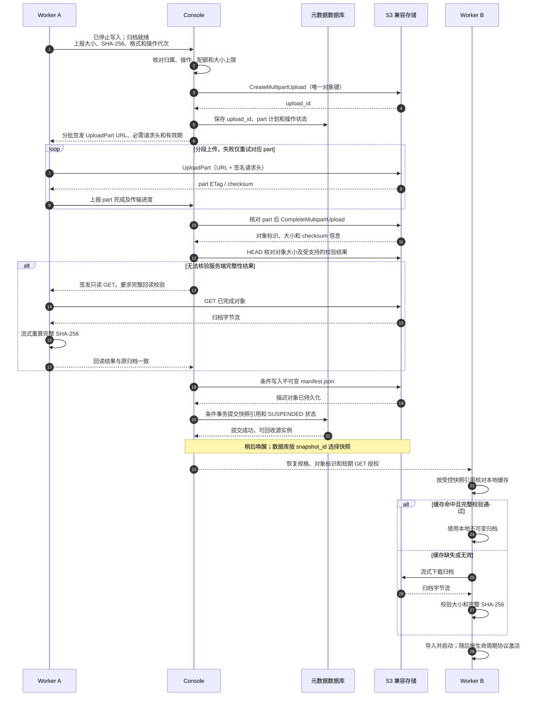

# 沙箱持久化：对象存储、性能与接口设计

## 状态与范围

本文补充[持久化与跨 Worker 唤醒时序](sandbox-session-persistence-lifecycle.zh-CN.md)，定义共享存储的职责、首期部署目标以及需要新增或调整的 API、配置和内部协议。本文描述首期完整设计，不表示所有验收项均已完成。已接入的接口与配置以[统一 API](../API.zh-CN.md#75-挂起--唤醒-session)、[Console 配置](../../console/docs/config-file.md#sandbox-persistence)及 [Docker 生命周期说明](../../worker/worker-docker/docs/sandbox-snapshot-controller.md)为准。Docker 已接入独立 lease 守护器，并通过实际 Worker 进程 SIGKILL 后到期停止、保留可写层的本机测试；BoxLite 已接入生产 runner 与独立 lease，真实 Console/S3 的本机跨 Worker 恢复、循环快照、无 Worker 后恢复与最终回收已通过；原生孤儿资源的安全协调和跨物理机器验收仍需完成。共享存储中未登记的已完成对象已有受宽限期与数据库准入隔离保护的扫描和清理，范围见 [Console 孤儿对象说明](../../console/docs/config-file.md#unregistered-storage-objects)。

首期仅支持 Docker → Docker、BoxLite → BoxLite，恢复为新启动的执行实例。共享存储保存约定的文件系统归档；Console 数据库保存会话、快照引用和所有权。共享对象存储不承担会话调度、分布式锁或运行中沙箱的文件读写。

## 共享对象存储的能力边界

### 必须具备的能力

“共享”指 Console、源 Worker 和目标 Worker 都可以通过网络访问**同一个持久化命名空间**，不依赖源机器存活或挂载源机器的磁盘。首期采用 S3 兼容 API，bucket 由部署者预先创建。

| 能力 | 首期要求 | 用途 |
| --- | --- | --- |
| 对象读写 | `PutObject`、`GetObject`、`HeadObject` | 小型快照描述、归档读取和提交前检查 |
| 分段上传 | Create / UploadPart / Complete / Abort Multipart Upload | 大归档并发上传、按 part 重试、中断清理 |
| 上传核对 | ListParts、按已知对象完整键查询的 ListMultipartUploads | 核对已登记上传及遗留 part；不要求 bucket 级未完成上传扫描 |
| 随机范围读取 | HTTP Range GET | 下载失败后从已验证的位置重试；最终仍校验完整归档 |
| 删除与清理 | DeleteObject；可分页 ListObjectsV2 | 删除已回收快照、巡检无引用对象；LIST 不参与选择最新快照 |
| 对象可见性 | 完成 PUT/Complete 后，同一对象的 HEAD/GET 立即可读到完整内容 | 防止元数据已提交、目标却读不到归档 |
| 完整性 | 支持可验证的上传 checksum，或允许完成后完整 GET 回读 | 提交前验证数据确实已写入；恢复后再次验证 |
| 有限授权 | SigV4 预签名 UploadPart / GET，含所需签名请求头与有效期 | Worker 直传，不分发 bucket 长期凭据 |
| 不可覆盖 | Console 对描述对象执行条件写入；归档由唯一 upload ID 完成；GC 对无引用对象使用 If-Match 条件替换 | 已提交 snapshot 的字节不可被后续重试覆盖 |
| 持久与可用 | 已确认提交的数据在 Worker 退出后仍保留；存储故障域独立于源 Worker | 满足跨 Worker 恢复，而非本机缓存复用 |

必须对实际使用的 S3 兼容服务验证这些语义，不能仅凭“支持 S3”认定全部兼容。Amazon S3 的强读后写一致性可作为这里的语义参考；对象存储不能替代数据库多记录事务。[S3 一致性模型](https://docs.aws.amazon.com/AmazonS3/latest/userguide/Welcome.html#ConsistencyModel)

### 不要求或不承担的能力

- 不要求 POSIX 挂载、目录 rename、文件锁或对对象追加写；不要让运行中的沙箱直接以对象存储作为根文件系统。
- 首期不依赖跨对象原子提交、全局对象锁或 bucket versioning。唯一对象键与 Console 数据库的条件事务决定有效快照。
- 不通过存储 LIST 推断 `latest`。最新快照必须读取数据库中已提交的引用。
- 不将原生内存快照、tmpfs、bind mount 或 volume 自动纳入根文件系统归档。
- 不保证基础镜像离线可用。首期仍需目标能按固定平台 digest 解析基础镜像；镜像 registry 是单独的依赖，不能拿可变 tag 代替固定版本。
- 不使用需要先取回才能 GET 的归档存储等级承载可即时唤醒的最新快照。历史快照分层存储不属于首期。

本地单盘服务可用于开发，但不能证明宿主机/磁盘故障后的数据耐久性。生产部署需按可接受的数据丢失风险选择独立持久磁盘、冗余和备份；同时备份 Console 数据库及存储配置。只有对象而没有会话引用、归档版本与恢复规格，不构成完整的恢复方案。

### 对象布局与数据所有权

首期采用每个 snapshot 独立、自包含的归档，不做跨会话去重或依赖上一快照的增量链。此处“自包含”要求文件系统归档带齐其原生磁盘 backing 依赖；基础镜像/启动配置依赖仍必须由恢复规格描述并可获取。

建议键结构：

```text
<prefix>/v1/<account_id>/<session_key_hash>/<snapshot_id>/archive
<prefix>/v1/<account_id>/<session_key_hash>/<snapshot_id>/manifest.json
```

归档内可包含文件级 manifest。外部 `manifest.json` 是小型描述对象，包含 schema version、runtime/平台、归档格式、镜像 digest、归档对象标识、大小、完整 SHA-256、文件系统范围和恢复规格摘要。环境变量等恢复配置可以含秘密，不通过公开快照信息接口返回；必要内容随受限归档保存，Console 数据库保留其受控引用。

Console 生成 snapshot ID 和对象键，固定账号归属，并持久化上传操作。调用方和 Worker 不能自行选择 bucket、任意对象键或待恢复的外部 URL。数据库保存逻辑存储 ID、bucket/key、可选 version ID、字节数和 SHA-256；**不保存预签名 URL 作为长期引用**。更换 bucket/endpoint 时需显式迁移存储映射及对象，不能修改配置后让已有引用指向另一套数据。

长期 AK/SK 仅由 Console 使用。Worker 取得与当前操作、快照、part 或下载对象绑定的短期授权，浏览器和普通调用方不取得上传授权。首期使用一个所有参与方均能访问的 endpoint；不能在签名后直接替换 URL 的域名。若使用内外网入口，应保证签名主机名在各网络中可解析到可达地址，或专门实现并验证双入口签名。

## 传输、校验与提交协议

首期归档统一走 multipart，描述对象由 Console 条件写入。Worker 只有 UploadPart 权限，**Complete 和 Abort 由 Console 执行**：完成后旧 upload ID 不能再用于修改这个归档。描述对象按 snapshot ID 唯一写入，提交后不再修改。

分段上传的重试、完成与中断是独立操作；遗留 multipart 不会因为客户端断开就自动消失，必须主动中断或配置生命周期回收。[Multipart 语义](https://docs.aws.amazon.com/AmazonS3/latest/userguide/mpuoverview.html)



**ETag、用户自填的 `x-amz-meta-sha256` 和 HEAD 成功都不能单独证明完整 SHA-256 匹配。**Multipart checksum 可能是 composite checksum，不能直接与本地完整文件 SHA-256 比较。适配器应明确记录算法与 full-object/composite 类型：支持可靠的服务端校验时，验证上传 part/对象校验链，并将其与源 Worker 对相同算法和字节范围计算的预期值比较、记录结果；不支持或无法确认语义时，源 Worker 必须对完成对象完整回读并比较 SHA-256，之后才允许提交。目标 Worker 无论采用哪条提交校验路径，都必须重算完整 SHA-256。[S3 校验类型](https://docs.aws.amazon.com/AmazonS3/latest/userguide/checking-object-integrity-upload.html)

上传授权快过期时，Worker 请求 Console 为当前未完成 part 重新签名，保留 upload ID；下载重试可重新取得授权。不得重新签发已取消操作的上传授权。实际有效期受签名 TTL、底层凭据有效期及存储端策略共同限制，操作 deadline 与 URL 有效期是两个独立边界。[预签名 URL 有效期](https://docs.aws.amazon.com/AmazonS3/latest/userguide/using-presigned-url.html)

Console 在 Complete、数据库提交或返回响应后崩溃，都需用同一操作 ID 核对进展；不能仅凭调用超时重新创建同名对象或删除源数据。恢复过程中的 HEAD/GET 返回 404 或 checksum 错误属于存储/快照故障，不能解释为 session 不存在并创建空白沙箱。

## 基本性能与容量建议

以下是首期**工程预算与验收目标**，不是当前实测数据、硬性产品限制或某家存储的性能承诺。验收应使用计划部署的实际 Worker、bucket 和网络。

| 项目 | 小规模部署起点 | 扩容/调整依据 |
| --- | --- | --- |
| 网络位置 | Worker 与对象存储优先同机房或同区域；endpoint 可双向访问 | 跨区延迟、带宽和流量成本需单独预算 |
| Worker 链路 | 1 Gbit/s 可作为起点；单任务有效传输目标约 60–100 MiB/s | 若要求多 GiB 归档数十秒内唤醒或多个并发恢复，优先 10 Gbit/s 级链路并实测 |
| 请求延迟 | 同区域 HEAD / 首字节 p95 目标不高于 100 ms | 这是部署目标；高 RTT 会影响分段和依赖解析 |
| 上传 part | 64 MiB，单归档并发 4 个 part | 按内存、网络、存储限流调整；必须满足服务端 part 数量和大小限制 |
| Worker 操作并发 | 快照 1、恢复 1 起步 | 共享总传输/临时磁盘准入预算，避免同时耗尽带宽和磁盘 |
| Console | 不代理归档字节；只处理控制、签名、描述对象及核对 | gRPC 不传大归档；URL 每批最多 64 个，进度最多每秒一次 |
| 存储吞吐 | 按所有 Worker 同时上传与下载的总量验收 | 不能把单流压测当作整个集群性能 |
| Worker 临时盘 | 本地 SSD；按实际导出/导入峰值预留，另加约 20% 余量 | 稀疏磁盘解压/导入可能扩大实际占用，不能只看压缩包大小 |

单个操作的粗略预算：

```text
C = 实际传输的归档字节数
B = 该操作能获得的有效传输吞吐（字节/秒）
T_suspend ≈ 排空/flush + 导出 + C/B_upload + 提交校验 + 元数据提交
T_resume  ≈ 调度/预留 + 基础镜像获取 + 归档获取/校验 + 导入 + 启动
缓存未命中：归档获取包含 C/B_download；缓存命中：改为本地读取和完整校验
```

流式校验可与传输重叠，公式用于保守预算；没有服务端可验证 checksum 时，提交校验还需额外完整下载一次，增加约 `C/B_download`。例如 **1 GiB 在 100 MiB/s 下单向传输约 10.2 秒，10 GiB 约 102 秒**，均不包括导出、解压、基础镜像拉取与 VM 启动。1 Gbit/s 链路下不能把任意 10 GiB 快照的唤醒目标设为几秒。

集群侧分别估算上传/下载聚合需求：`同时传输数 × 每任务吞吐目标 × 1.2`。例如 4 个并发恢复各需 100 MiB/s，存储与共享网络的读取预算约为 480 MiB/s；1 Gbit/s 的共享上行无法满足。1.2 是容量余量建议，不是吞吐保证。

临时盘按以下组成核算，不固定套用“快照大小的两倍”：

```text
峰值本地占用 = 仍保留的运行/停止实例磁盘 + 本地归档缓存
             + 导出临时文件 + 下载文件 + 解压/导入暂存 + 运行时额外磁盘
```

如果实现把 part 缓存在内存，内存上界还受 `part_size × 单归档并发 × 同时上传数` 影响；64 MiB × 4 × 2 已达 512 MiB，未计 SDK、压缩器与 runtime。优先使用有背压的磁盘/流式传输。

存储容量预算至少计入当前有效快照、暂时保留的上一代、上传中 part、未提交对象及删除宽限期。新上传前需要为账号保留临时配额，不能因为旧快照尚未回收，就在写到一半时发现 bucket 已满。

性能验收覆盖 1 / 5 / 10 GiB 的真实归档、单任务和 4 任务并发、冷/热镜像缓存，以及大量小文件样本。分别记录导出、上传、校验、下载、导入、启动时间和临时磁盘峰值；带宽按 `MiB/s`、网络端口按 `Gbit/s` 记录，避免单位混用。

## 需要新增与调整的外部 API

### 首期入口

新增接口沿用现有 `/api/v1/sessions*` 的管理认证和账号作用域：cookie、Console API key 或 Dashboard JIT；普通 execution token 不因此获得管理权限。管理员对单会话操作继续显式传 `account_id`。跨账号访问返回 404。

| 类型 | API | 目标语义 |
| --- | --- | --- |
| 新增 | `POST /api/v1/sessions/:session_id/suspend` | 显式开启/执行持久化挂起；首次将临时会话转为持久化会话 |
| 新增 | `POST /api/v1/sessions/:session_id/resume` | 从最新已提交快照在同 runtime 的兼容 Worker 上恢复 |
| 新增 | `GET /api/v1/sessions/:session_id/operations/:operation_id` | 查询异步挂起/恢复的阶段、进度、错误和最终结果 |
| 调整 | `GET /api/v1/sessions`、`GET /api/v1/sessions/:session_id` | 挂起后仍可见；返回生命周期、持久化信息和当前操作 |
| 调整 | `POST /api/v1/sessions/:session_id/renew` | 仅续租 RUNNING 实例；SUSPENDED 时返回状态冲突，不隐式唤醒 |
| 调整 | `DELETE /api/v1/sessions/:session_id` | 逻辑删除稳定会话、撤销路由/执行权并取消操作；后台清理实例和快照 |
| 调整 | `terminalExec`、`terminalResource`、公开预览 resolve | 区分“已挂起”与“不存在”；不借 `create_if_missing` 创建空白实例 |

首期不新增快照公开上传、下载、任意 snapshot 回滚或 runtime 强制切换 API。恢复只选择数据库中该会话最新的已提交快照。基础镜像与 runtime 由首次创建的恢复规格决定，调用方不能在 resume 中指定任意镜像、Worker 文件路径或外部归档 URL。

### 请求、响应与幂等

`suspend` 示例：

```http
POST /api/v1/sessions/sess_xxx/suspend
Idempotency-Key: suspend-request-123
Content-Type: application/json

{"retention_ttl_sec":604800}
```

`resume` 示例：

```http
POST /api/v1/sessions/sess_xxx/resume
Idempotency-Key: resume-request-456
Content-Type: application/json

{"lease_ttl_sec":300}
```

新操作接受后返回 `202 Accepted` 和 `Location` 查询地址，HTTP 连接不等待整份归档传完。HTTP 客户端断开不自动取消已接受的操作：

```json
{
  "operation_id": "op_xxx",
  "session_id": "sess_xxx",
  "kind": "resume",
  "status": "pending",
  "phase": "scheduling",
  "generation": 4,
  "progress": {"bytes_completed": 0, "bytes_total": null},
  "error": null
}
```

两个 POST 均要求 `Idempotency-Key`。`retention_ttl_sec` 可省略并使用配置默认值，显式值必须为正且不超过配置上限；`lease_ttl_sec` 必须为正并满足目标 Worker 的 lease 范围。参数无效返回 400。

操作状态使用 `pending/running/succeeded/failed/canceled`；`phase` 表示 `draining/exporting/uploading/verifying/committing/scheduling/downloading/importing/starting/activating/cleaning` 等阶段。字节进度只代表当前传输阶段，不把下载 100% 等同于整个唤醒完成。查询返回 `200`，失败操作包含 `error.code`、`message` 和 `retryable`。

同一账号、session、操作种类、幂等键及相同参数复用原操作；同键不同参数返回 409。并发的同种目标操作合并到当前操作，不重复创建实例。相反方向操作尚在进行时返回 409，不默认取消它。已处于目标稳定状态时返回 `200` 会话当前状态；仍在进行的操作返回 `202` 和已有操作 ID。幂等记录至少保留到对应操作结束后 24 小时，不能只保存在 Console 内存。

如果接受请求前即可确定没有可用候选或容量，允许同步返回现有 503/429 错误而不创建操作；接受后才发现同样问题，则在操作结果中返回相同错误码。客户端应同时处理“提交请求失败”与“异步操作失败”，不能把 `202` 当作唤醒成功。

### 会话返回结构变化

```json
{
  "account_id": "acc_xxx",
  "session_id": "sess_xxx",
  "lifecycle_state": "suspended",
  "worker_id": null,
  "status": null,
  "lease_expires_at": null,
  "persistence": {
    "enabled": true,
    "runtime": "boxlite",
    "platform": "linux/arm64",
    "retention_expires_at": "2026-10-24T00:00:00Z",
    "latest_snapshot": {
      "snapshot_id": "snap_xxx",
      "created_at": "2026-10-17T00:00:00Z",
      "size_bytes": 1073741824,
      "sha256": "<完整归档SHA-256>"
    }
  },
  "current_operation_id": null
}
```

`lifecycle_state` 使用 `running/snapshotting/suspended/restoring/deleting`，与原有连接可用性 `status=ready/unavailable/reconciling` 分开。没有运行绑定时 `status`、`worker_id` 和运行 lease 为 null；恢复中的目标 Worker 不提前冒充活动绑定。保留原有列表分页和账号隔离。

首次成功挂起后，`persistence.enabled=true`；归档提交前的首次挂起失败不能把不存在的快照标为可恢复。挂起保留期从挂起成功提交时计算，重新成功挂起可重新计算；运行期间不按挂起保留期删除当前有效快照。唤醒不靠 `/renew`，延期数据保留也不冒充运行 lease 续租；首期不提供单独修改挂起保留期的接口。

`DELETE` 继续以 `204` 表示逻辑删除成功，不承诺对象字节已立即物理擦除。需持久化删除任务并最终执行对象清理；对象删除失败可重试，不能重新暴露已删除会话。正在运行/恢复的实例先失去执行权，再回收数据；有效操作引用未解除前不删除它使用的对象。

### 错误契约

| 场景 | 错误码 / HTTP | 处理 |
| --- | --- | --- |
| 无同 runtime、平台/格式兼容的在线候选 | 复用 `no_worker` / 503 | 保留 SUSPENDED 与快照，稍后重试 |
| capability 容量不足 | 复用 `no_capacity` / 429 | 同上 |
| Worker 最终准入拒绝 | 复用 `session_capacity_exceeded` / 429 | 安全取消预留后可选择其他兼容候选 |
| 操作冲突或在挂起状态执行/续租 | 新增 `session_state_conflict` / 409 | 返回当前生命周期与操作 ID；不创建空白实例 |
| 账号快照配额或单快照大小超限 | 新增 `snapshot_quota_exceeded` / 413 | 不提交快照，不回收源唯一数据 |
| 对象缺失、传输或 checksum 校验失败 | 新增 `snapshot_storage_error` / 502、`snapshot_integrity_error` / 502 | 保留有效引用，报告具体阶段；不映射为 session_not_found |
| 超过整个操作 deadline | 复用 `timeout` / 504 | 先核对后端实际状态；超时本身不证明旧实例已停止 |
| 功能关闭或存储初始化不可用 | 新增 `persistence_unavailable` / 503 | 禁止接受新的持久化操作；已有记录保留 |
| 会话不存在或跨账号 | 现有 404 语义 | 与“存在但无法恢复”区分 |

异步操作失败时，查询本身仍为 HTTP 200，上表状态码表达相应同步拒绝及错误类别；操作对象通过 `error.code` 返回。公开预览在挂起/恢复期间返回不可用响应，不返回内部存储凭据。首期要求显式 resume，不让普通命令或匿名预览流量隐式创建恢复任务。

## 内部协议、数据模型与现有能力调整

### Console ↔ Worker 控制协议

复用现有 gRPC `Connect` 双向连接，但新增持久化控制消息和进度/核对报告，**不把长时间操作塞入普通 terminalExec 的命令时限与结果缓存**。建议动作如下；具体 protobuf 字段号在实现时确定。

| 动作 | Worker 责任 |
| --- | --- |
| `prepare_snapshot` | 核对 session/操作/代次，拒绝新命令，排空/停止写入，导出到受控暂存区，上报大小、格式和 SHA-256 |
| `upload_snapshot` | 申请当前 part 的授权，上传并上报 ETag/checksum/进度；需要时执行完成对象回读 |
| `finalize_suspend` | 只在 Console 确认快照提交后清理源实例；可按预算保留已提交归档缓存，重试不恢复旧实例 |
| `prepare_restore` | 校验恢复兼容性并原子预留 session 与临时盘/传输容量 |
| `restore` | 先校验匹配的本地归档缓存，未命中则下载；随后导入和启动，保持用户入口关闭 |
| `activate` | 核对数据库确认对应的操作和代次后开放当前实例执行权 |
| `cancel` / `inspect` | 幂等停止未激活实例、释放预留，或上报操作及实例的真实状态 |

消息必须携带账号作用域 session ID、operation ID、generation、deadline；恢复再携带 snapshot 描述及资源规格。Worker 报告阶段、已传字节、part 状态、实例状态和执行租约。重复 control 需复用已存在操作，不能导出/恢复出多个实例。未结束操作及与本地资源的关联需持久保存，Worker 重启后可以 inspect。

ConnectHello 已有 `executor_kind` 与普通 Worker 版本，但不足以判定归档兼容性。新增结构化报告：runtime 名称/版本、guest OS/架构、支持的读写归档格式版本、文件系统语义能力、持久化功能启用状态、暂存空间和快照/恢复并发上限。Heartbeat 扩展报告当前操作预留与可用暂存空间。恢复中的实例计入现有 terminal session 容量，不能因尚未发布 route 而绕过上限。

原 candidate/report/ack 恢复协议需要增加生命周期、generation 和未完成操作核对；旧 Worker 报 `MISSING` 不能删除一个已挂起、数据仍在共享存储中的稳定会话。Console 重启时需要恢复持久化操作，不沿用普通非终态 task 一律 `console_restarted` 失败的策略。

上传授权续签可通过新增 transfer request/grant 消息在该连接中完成，由 Console 校验操作后分批响应。不新增面向普通调用方的 Worker 对象存储上传 API。

### 元数据与 GC

新增稳定 session、snapshot、persistence operation、transfer/part、deletion job 记录；运行 route 仅代表当前绑定。数据库提交以 session generation 和 operation ID 为条件，提交有效 snapshot 与 SUSPENDED 状态、撤销旧 route 在同一事务中完成。

GC 先根据数据库确认对象没有有效会话引用、没有进行中的恢复/上传引用，并超过宽限期；再用条件事务将 snapshot 标记为 deleting，禁止建立新引用，之后才删除对象。恢复预留必须与该状态互斥，不能在 GC 检查之后又引用即将删除的对象。建议当前有效快照与上一代短期保留；额外历史 snapshot 不必对外提供回滚 API。过期挂起会话按策略逻辑删除，再回收对象。bucket lifecycle **不能按对象年龄自动删除所有快照**，否则仍被会话引用的数据可能先消失。

MinIO 的 multipart 列举按完整对象键查询；启动探针据此验证已知 upload ID，不据此声称支持整个前缀的未完成上传扫描。未登记上传应配置 bucket 生命周期兜底，不能只依赖当前 Console 的已登记操作清理。[MinIO 实现](https://github.com/minio/minio/blob/RELEASE.2025-10-15T17-29-55Z/cmd/erasure-multipart.go)

可为“未完成 multipart”配置 24 小时后的中断回收；它应显著大于操作 deadline。无引用的已完成对象由 Console GC 处理。GC 错误和权限错误必须有可观察的积压指标，不能只记录一次日志。

### 现有实现可复用的部分

[`console/internal/objectstore`](../../console/internal/objectstore/objectstore.go) 中的 `Store` 提供用户文件 PUT/GET 预签名，使用 `CONSOLE_EXPORT_FILE_*` 配置服务于 `exportFile`。`SnapshotStore` 提供 multipart、HEAD/GET 校验、不可变描述对象、按版本删除与启动能力探测；持久化删除任务、已登记无引用快照 GC 及专用命名空间内未登记的已完成对象扫描已接入。孤儿对象清理会中止其精确 key 的未完成 multipart；只有未完成上传、尚无可列举已完成对象的 key 仍依赖 bucket 的未完成 multipart 生命周期策略，不能据对象扫描推断全部遗留上传已回收。

可以复用 AWS SDK 依赖、客户端构建和签名基础，新增 snapshot store 接口；不要把 `exportFile` 用户文件导出的保留期、凭据或返回 URL 直接当作 session snapshot 契约。建议 snapshot 使用独立 bucket，至少使用独立 prefix 和生命周期规则。`exportFile` 现有配置与行为保持独立。

后续实现应同步更新 `docs/API.md` / `docs/API.zh-CN.md`、Console/Worker 配置参考和示例、Worker 注册/心跳协议、会话状态与公开预览行为。本文只描述计划，不在统一 API 参考中把未实现端点发布为可用接口。

## 拟新增配置与起始值

以下名字、默认值均为首期设计建议。`config.toml` 键沿用对应环境变量去掉 `CONSOLE_` / `WORKER_` 前缀并转为小写的项目惯例；环境变量优先。

### Console

| 环境变量 | 建议默认值 | 含义 |
| --- | --- | --- |
| `CONSOLE_PERSISTENCE_ENABLED` | `false` | 是否接受新的持久化挂起/恢复 |
| `CONSOLE_SNAPSHOT_STORE_ENDPOINT` | 必填 | 所有参与方可达的 S3 endpoint |
| `CONSOLE_SNAPSHOT_STORE_REGION` | 必填 | 签名 region |
| `CONSOLE_SNAPSHOT_STORE_BUCKET_NAME` | 必填 | 预创建的 snapshot bucket |
| `CONSOLE_SNAPSHOT_STORE_PREFIX` | `session-snapshots` | 快照命名空间；禁止与用户 export 前缀重叠 |
| `CONSOLE_SNAPSHOT_STORE_AK` / `CONSOLE_SNAPSHOT_STORE_SK` | 必填 | Console 的存储凭据；Worker 不配置它们 |
| `CONSOLE_SNAPSHOT_STORE_FORCE_PATH_STYLE` | `false` | 兼容需要 path-style 寻址的部署，需实测签名可达性 |
| `CONSOLE_SNAPSHOT_STORE_INTEGRITY_MODE` | `readback` | `readback`：提交前完整回读；`server_verified`：仅在适配器和服务端校验语义已验收后启用 |
| `CONSOLE_SNAPSHOT_PRESIGN_TTL_SEC` | `900` | 单批传输授权 TTL；可续签，不等于整个操作时限 |
| `CONSOLE_SNAPSHOT_MULTIPART_PART_SIZE_BYTES` | `67108864` | 64 MiB；初始化时校验服务端限制 |
| `CONSOLE_SNAPSHOT_MULTIPART_CONCURRENCY` | `4` | 单个归档上传的并发上限，Worker 可按本地预算进一步降低 |
| `CONSOLE_SNAPSHOT_MAX_BYTES` | `10737418240` | 单快照传输归档上限 10 GiB |
| `CONSOLE_SNAPSHOT_MAX_EXPANDED_BYTES` | `53687091200` | 导入物化字节/磁盘预算起点 50 GiB，适配器需明确展开计量，不能只信归档头 |
| `CONSOLE_SNAPSHOT_ACCOUNT_QUOTA_BYTES` | `107374182400` | 账号归档与上传预留预算起点 100 GiB；含尚未回收的旧代 |
| `CONSOLE_PERSISTENCE_RETENTION_TTL_SEC` | `604800` | 默认挂起保留期 7 天 |
| `CONSOLE_PERSISTENCE_MAX_RETENTION_TTL_SEC` | `2592000` | 请求保留期上限 30 天 |
| `CONSOLE_PERSISTENCE_OPERATION_TIMEOUT_SEC` | `1800` | 整个挂起/恢复操作 deadline；各阶段在剩余预算内执行 |
| `CONSOLE_SNAPSHOT_GC_INTERVAL_SEC` | `300` | 每 5 分钟扫描可回收记录 |
| `CONSOLE_SNAPSHOT_GC_GRACE_SEC` | `86400` | 未引用对象及旧代快照回收宽限期起点 24 小时 |

启用时若缺少必填配置或基本存储能力探测失败，Console 应明确报错，不静默把持久化切换为仅本地磁盘。启动探测使用隔离探测前缀执行写入、HEAD/GET、multipart 与删除，生产验收另外覆盖账号权限和故障场景。运行期间的临时存储不可用不能使已有持久化会话记录被删除。

关闭功能仅禁止新的 suspend/resume，不触发快照删除；已接受的操作应被核对并安全收尾。需另行恢复的挂起会话在关闭期间返回 `persistence_unavailable`。配置/存储迁移应保留旧存储映射；不能通过关闭开关来绕过引用核对和删除协议。

### Docker / BoxLite Worker

同节点恢复不新增外部 API。Worker 可以附带受限的缓存提示供调度择优，但 Console 不把它作为正确性依据；实际恢复以当前 snapshot 引用和完整校验为准。完整时序见[本地归档缓存路径](sandbox-session-persistence-lifecycle.zh-CN.md#在原-worker-上恢复本地归档缓存路径)。

| 环境变量 | 建议默认值 | 含义 |
| --- | --- | --- |
| `WORKER_PERSISTENCE_ENABLED` | `false` | 是否宣告并接受持久化控制；未启用的 Worker 不进入恢复候选 |
| `WORKER_SNAPSHOT_TMP_DIR` | 显式配置的本地 SSD 目录 | Worker 专用暂存；重启保留未完成操作的必要数据 |
| `WORKER_SNAPSHOT_LEASE_GUARD_IMAGE` | Docker 启用持久化时必填 | 已加载且以仓库 digest 或完整 image ID 固定的可信独立守护器镜像；需符合 schema 2 部署契约 |
| `WORKER_SNAPSHOT_LEASE_GUARD_DOCKER_SOCKET` | `/var/run/docker.sock` | Docker daemon 所在主机的 Unix socket；不是 Worker 客户端所在主机的路径 |
| `WORKER_SNAPSHOT_CACHE_MAX_BYTES` | `10737418240` | 已提交归档缓存预算起点 10 GiB；`0` 禁用缓存，缓存计入暂存总预算而非额外增加预算 |
| `WORKER_SNAPSHOT_CACHE_TTL_SEC` | `86400` | 未被操作固定引用的缓存最长保留 24 小时；容量压力下可提前 LRU 淘汰 |
| `WORKER_SNAPSHOT_MAX_INFLIGHT` | `1` | 同时快照数，不等于普通命令 max_inflight |
| `WORKER_RESTORE_MAX_INFLIGHT` | `1` | 同时恢复数，与现有 session 容量共同准入 |
| `WORKER_SNAPSHOT_TMP_QUOTA_BYTES` | `107374182400` | 暂存总预算起点 100 GiB；还需检查实际文件系统剩余空间与峰值预留 |
| `WORKER_SNAPSHOT_TRANSFER_MAX_CONCURRENCY` | `4` | 整个 Worker 的传输请求并发上限，而非每个归档各自无上限 |
| `WORKER_SNAPSHOT_DRAIN_TIMEOUT_SEC` | `60` | 停止接收新命令后的排空预算；超时失败，不擅自强杀后声称一致 |
| `WORKER_SNAPSHOT_TRANSFER_IDLE_TIMEOUT_SEC` | `60` | 无字节进展的传输超时，独立于 URL TTL 与整个操作 deadline |

缓存位于专用暂存目录的受控子目录，只允许登记已完成提交的不可变归档。归档从暂存转为缓存时按同一文件计量，不能重复预留或解除预算；未提交的源数据和进行中操作固定引用的文件不参与缓存淘汰。

不新增 Worker 的 bucket AK/SK 配置。Worker 资源预算不足应在导出或恢复前拒绝；临时目录不能指向沙箱内部 `/tmp`。BoxLite 原生导出与 Docker 归档的物化/临时盘需求不同，由各适配器计算，不用同一个压缩比猜测。

运行实例 lease 仍由现有会话配置管理；不能把 30 分钟快照 deadline 直接当作沙箱 execution lease 或数据保留期。操作期间的源实例/目标预留需由持久化协议持有，避免现有 lease janitor 在快照提交前删掉唯一磁盘。

Docker 的两个 lease guard 配置已实现，配置文件键为 `[snapshot].lease_guard_image` 和 `[snapshot].lease_guard_docker_socket`。守护器的容器与持久卷独立于 Worker 进程存活；Worker 在 Hello 前核对 daemon、镜像、容器、卷和 lease store 身份，并连续观察进程稳定运行十秒。原始绑定丢失或资源被替换时拒绝启动，不能初始化空 ledger 后继续恢复。首次采纳先记录原容器 ID 与绝对 lease，取得守护器确认后才返回成功；恢复及回滚在 native start 前取得确认，续租在持久化意图后取得精确回执。完整部署约束和已验证边界见[独立执行租约](../../worker/worker-docker/docs/runtime-lease-guard.md)。BoxLite 使用独立进程与私有 Unix socket，配置和验证边界见[BoxLite 部署说明](../../worker/worker-boxlite/docs/sandbox-snapshot-deployment.md)。

## 首期验收清单

- Console、A、B 均可访问 bucket；在 A 不可达时 B 能恢复，基础镜像凭据和平台 digest 可解析。
- 真实服务通过单对象/分段上传、续签、断点重试、完整校验、HEAD/GET 一致性、删除与遗留 part 清理测试。
- 注入 part 失败、Complete 响应丢失、数据库提交失败、Console/Worker 重启、目标下载损坏；均不提前删除唯一有效数据、不生成双活动实例。
- 覆盖无候选、capability 满载、Worker 最终准入拒绝，分别复用现有 `no_worker/no_capacity/session_capacity_exceeded`。
- `202` 后轮询成功/失败、幂等重试、跨账号隔离、挂起列表可见、续租冲突、删除期间取消与物理清理积压均有明确结果。
- 覆盖同节点缓存命中、缓存被淘汰、字节损坏、快照版本不匹配、原节点满载，以及恢复期间缓存淘汰竞争；核实不会读取旧快照或恢复出第二个有效实例。
- 根据实际 1/5/10 GiB、冷/热镜像与归档缓存及并发数据，确定操作时限、临时盘和吞吐配置，再承诺挂起/唤醒 SLO。

BoxLite 的本机证据包括 [4 × 1 GiB 禁用归档缓存](../../worker/worker-boxlite/docs/sandbox-snapshot-s3-parallel-cold-sample-2026-10-25.json)、[4 × 1 GiB 实际缓存命中](../../worker/worker-boxlite/docs/sandbox-snapshot-s3-parallel-warm-sample-2026-10-25.json)及[恢复复制与生产淘汰 I/O 竞争](../../worker/worker-boxlite/docs/sandbox-snapshot-cache-copy-eviction-sample-2026-10-25.json)。后者在真实 Console/S3 恢复期间由独立进程调用 Worker 使用的生产淘汰函数，验证忙锁保留、复制后回收、独立目标和最终清理；周期 GC 策略与调度由另外的 Rust 测试覆盖。上述证据不等于跨物理机器、受控冷/热镜像性能矩阵或生产 SLO 验收。

[1 GiB 分阶段与磁盘采样](../../worker/worker-boxlite/docs/sandbox-snapshot-stage-sample-2026-10-25.json)另行覆盖单会话跨 Worker 下载和同 Worker 缓存复制，保留逐 operation/attempt 的导出、上传、完整校验、下载/复制、导入、启动及源清理耗时，以及创建数据前至最终清理后的 SDK home/journal 计量曲线。采样、COW/reflink、既有缓存及未计入路径的限制已随样本记录；不能将其当作精确物理峰值或全部存储吞吐验收。

[1 GiB SDK 镜像缓存样本](../../worker/worker-boxlite/docs/sandbox-snapshot-sdk-image-cache-sample-2026-10-25.json)使用相同源/目标 Worker 和 home，关闭快照归档缓存，两次均从 S3 下载。目标 SDK 冷态以空索引/空文件清单及实际拉取日志确认，热态以指定 digest 的完整索引/缓存文件及实际复用、无拉取日志确认。探针按固定 SDK 0.10.7 只读校验，不删除缓存，不控制 registry/CDN 或 OS 页缓存。这是顺序单次的 SDK 缓存条件检查；多次重复、其他体量与并发的完整镜像/归档矩阵、跨机器及部署存储网络测量仍需完成。
