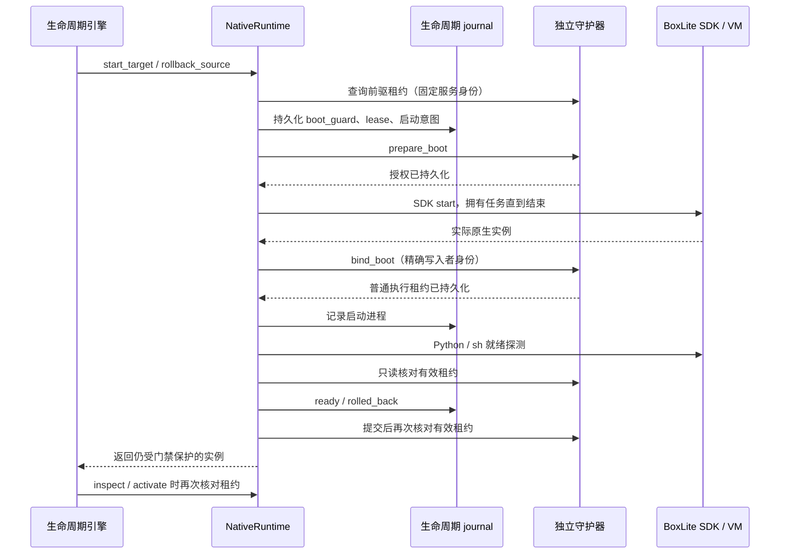
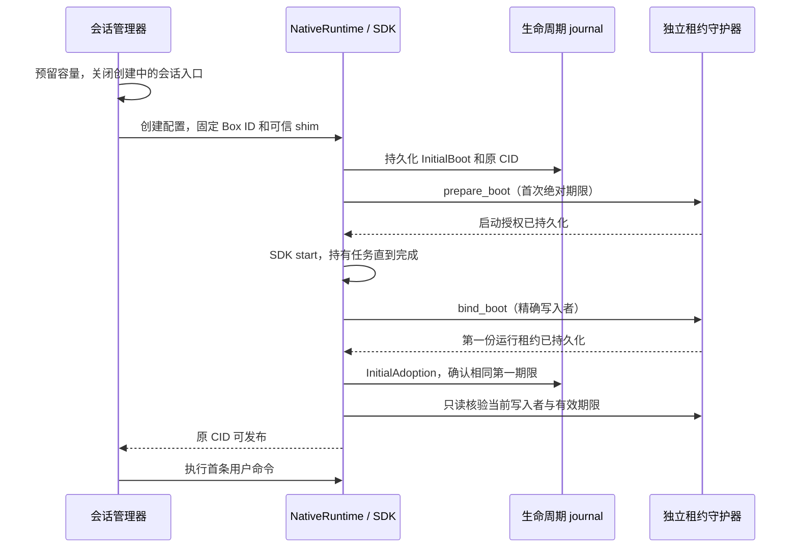
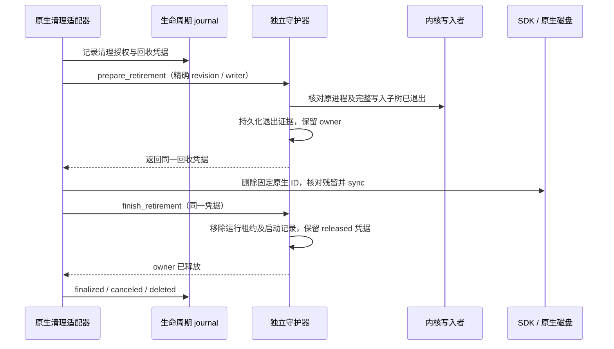

# 持久执行租约账本与到期执行

`ExecutionLeaseLedger` 实现 BoxLite 独立租约守护器的账本、首次运行实例采纳、启动前授权、进程绑定、CAS 续租及到期执行视图。它使用[精确写入者身份与停止原语](sandbox-snapshot-runtime.md#独立停止原语)，不删除 guest 磁盘，也不调用 SDK 启动、停止或删除 API。调用方负责在独立于 Worker 的进程及独立于磁盘写入的执行线程中持续调用 `enforce`。

已提供 `boxlite-lease-guard` 独立二进制及私有 Unix 控制通道，原生实验通过该二进制完成采纳、续租与到期停止。生产启动绑定、监督、受控启动路径接入及 Worker 注册尚未完成。`sandbox_persistence` 仍不宣告；此组件不能单独作为完整持久化能力启用。

## 状态与归属

专用绝对目录必须属于当前用户，权限为 `700`；`guard.lock`、`owner.json` 与 `leases.json` 为私有、单硬链接普通文件，权限为 `600`。目录不能作为沙箱挂载或归档缓存目录。生产集成还必须校验它与 SDK home、生命周期 journal 的分离关系。

`owner.json` 固定 Worker ID、宿主身份、随机 store ID，以及目录的规范路径、设备号和 inode。`leases.json` 携带相同 store ID，运行租约、启动授权及回收凭据各最多保留 16,384 条，整个 JSON 不超过 64 MiB。回收凭据不会自动淘汰；达到上限时拒绝新增回收，不能删除历史后把旧 scope 当成首次创建。记录包含 scope、不可变 Box ID、generation、revision、绝对到期时间及精确宿主写入者身份，不包含 Console secret、恢复规格环境变量或对象存储授权。

文件通过私有临时文件、文件 sync、原子替换及父目录 sync 提交。失去账本但保留 owner、复制或替换目录、不同 Worker/host、损坏或重定向的文件都拒绝打开。识别到的中断临时文件仅在完整归属与账本校验后清理，未知文件保持不可用。打开期间，控制操作还会核对目录、owner 及独占锁文件身份；原路径被替换时不能跟随到新存储继续写入。

`open` 用于首次受控建立存储；已绑定 Worker 必须使用 journal 中固定的 store ID 调用 `open_bound`。绑定重开时，整个目录或 owner 丢失也会拒绝，不初始化空账本。生产启动仍须把 store ID、目录和守护进程身份与生命周期 journal 配对，不能在重启时重新读取一个新 ID 后替代原绑定。

## 确认与时钟

首次采纳仅接受已运行、精确身份一致的原实例，generation 和初始 revision 均为 `1`。确认前后均重新核对实际写入者。相同已接受请求可重放；更换 scope、generation、进程、Box ID，或为同一 scope 建立另一个 ID 均拒绝。已撤销、过期或重开账本中的旧记录不能通过 `adopt` 恢复执行权。

续租携带 expected revision 和完整目标回执。它保持同一身份，不缩短到期时间，成功后 revision 加一；丢失应答可重放同一已接受结果。缺失记录不能通过续租创建。多个调用竞争相同 revision 时，只能确认其中一个不同的目标结果。

每个运行租约同时保存绝对到期时间和内存中的单调时钟期限，任一到期都会关闭执行权。续租通过原单调期限加上本次明确授权的延长量得到新期限，不以回退后的墙钟重新计算一个更长期限。到期观察是不可逆的，即使墙钟随后回退也不重新开放。

重开账本时无法证明旧单调时钟连续性，因此全部历史记录在新进程的执行视图中撤销，包括绝对时间仍未到期的记录。状态回执中的 `revoked` 包含这一有效状态；revision 记录已接受的持久化 CAS，不会因轮询或重启自行增长。撤销状态不通过修改磁盘上的 lease 时间来延长或刷新旧 grant。

`check_running` 是普通请求的只读执行权核验：除了有效 lease，还要求相同 Box ID 对应的精确内核写入者仍存活。缺失、撤销、到期或已退出的记录都拒绝；它不增加 revision，也不创建记录。管理查询 `status` 则保留停止前驱的完整记录，供核对和明确重新授权使用；不能把 `status` 返回记录当成当前执行许可。

## 磁盘阻塞与到期动作

磁盘状态锁和到期视图的锁分离。首次采纳在不确定写入前登记原实例为停止目标；任何不确定写入都会关闭账本控制入口，并使所有已知目标进入停止路径，包括未得到成功回执的首个实例。

续租写盘期间，旧期限继续有效。新状态持久化后，只有原期限仍有效、实例仍匹配且没有发生停止决定，才原子发布新期限并确认。写入拖过旧期限时，到期执行可以先停止原进程；磁盘后来写入了更远的时间也不能返回续租成功。持久化意图不能代替控制回执。

到期扫描不读取账本目录，不取得磁盘状态锁，也不等待 sync。每轮对已绑定租约和未绑定启动的已知写入者分别最多投递 64 个精确停止请求，失败目标继续保留并轮转重试。停止投递与期限发布使用同一实例锁，旧扫描不能在续租已发布后再误停实例。调用频率、队列积压和内核可响应性共同影响停止延迟，这个上限不是生产停止时限承诺。停止请求成功仍须由生命周期协议另行核实写入者退出；不能只凭墙钟或 Worker 不可达就转移所有权。

## 启动前的写入者识别

BoxLite `0.10.7` 在发布 `shim.pid` 前已可能创建原生进程并发送启动配置。因此，PID 文件缺失不能证明没有可写实例。

受控 target 启动和 source 回滚在 SDK start 前准备独立的 `boxes/<Box ID>/bin/boxlite-shim`，核对可信 SDK 可执行文件的 SHA-256，固定目录及文件的设备号、inode、大小和时间戳，并将 `BootExecutable` 与启动意图一同写入生命周期 journal。启动后必须核对实际写入者属于该可执行文件；已有文件异常时拒绝覆盖或修复。此路径要求默认 jailer 且不使用自定义 sandbox profile。启动前清单还核对证据属于配对的 SDK home；已完成清理的历史记录只校验绑定元数据，不要求保留已删除的原生文件。

macOS 通过内核 audit token 中的 PID/version 查询可执行路径，Linux 通过 `/proc` 可执行路径和精确 cgroup 身份核对写入者；不读取进程环境变量。发现的进程属于正向证据，空结果不能证明没有尚未完成的 SDK start，也不能授权清理或另一份根的启动。原生任务所有权、停止确认和独立执行租约仍须分别成立。

### 启动授权与运行绑定

`prepare_boot` 接受 operation、scope、Box ID、generation、前驱 revision（首次为空）、绝对到期时间、发起 Worker 的精确宿主进程身份和固定的可执行文件证据。守护器先持久化授权，再确认可调用 SDK start；它不调用 SDK，也不替调用方创建 VM。原生调用方必须先记录生命周期启动意图，保持准入关闭，并拥有 SDK 任务直到完成。

同一未绑定授权可精确重放，修改任何授权字段均拒绝。已有运行租约的同一根只能在原写入者实际退出、scope/generation 匹配且前驱 revision 一致时重新授权；新绑定的 revision 在该值上加一。旧停止视图在授权确认前退出执行，避免 Linux 重用同一 cgroup 时旧期限误杀新实例。不同根不能占用已保留的 scope，未确认结果不能被新操作覆盖。

`bind_boot` 只在原 SDK start 任务已经结束后调用。它要求发起 Worker 身份仍然有效、实际进程与内核发现的全部写入者属于同一实例，并原子持久化绑定结果和普通执行租约。确认后进入现有 CAS 续租路径，原启动期限不再单独执行。绑定过程中写盘拖过旧期限不能获得成功回执。重开账本仍撤销历史授权；未来到期时间不构成重新执行许可。

独立进程发现线程在授权后持续查询原生写入者，生命周期账本写入和 Unix 请求不占用它。已经发现的精确身份还由普通到期线程维护，后续可执行文件查询阻塞或失败也不延迟这些已知进程的停止。原生进程发现本身依赖操作系统与 SDK home 的可查询性；无法取得身份的结果持续保留，不能作为停止确认。

未绑定启动即使已停止一个发现的进程、发起 Worker 已结束或暂时发现不到进程，也保持未确认状态。`boot_status` 返回持久化意图，不能作为仍有效的执行授权。服务关闭持续等待该结果的明确核对，不把空查询转成关闭成功；当前尚未提供这类未知启动结果的生产协调与释放接口。

这些原语已通过私有 Unix 通道和真实 VM 实验验证。原生启动适配器已接入下述授权/绑定顺序；Worker 启动配置、全局 store/home 配对、完整重连协调及服务监督尚未接入，生产能力保持关闭。

### 原生启动适配器与 journal

`NativeRuntime::with_execution_guard` 为该适配器的 `start_target` 和 `rollback_source` 固定客户端。SDK start 前，journal 将 `boot_guard`、可执行文件证据、绝对 lease 和启动意图一同落盘。`boot_guard` 保存完整守护器身份和本次授权，之后不可替换或移除；journal 加载时也核对 Worker。未配置守护器的适配器不能重放已有受保护操作。



重试运行中的实例时，只核对 journal 固定的守护器、scope、generation 和精确进程，不重复 SDK start。有效租约已绑定时直接查询；尚未完成绑定时，仅原授权仍有效且原生 start 已结束，才提交相同绑定。回滚需要延长已有运行租约时，使用明确传入的绝对期限执行 CAS 续租，不靠重放生成新期限。守护器重启或 epoch 被替换时不能静默更换绑定。

源实例始终运行、回滚只需重新开放访问时，不创建启动授权。适配器记录同一服务身份，并要求守护器已有该原实例的有效执行租约；它不会事后自动采纳未知实例。该路径同样禁止降级为无守护器重放。

### 首次 VM 创建与接管前的访问

配置守护器的管理器使用专用创建接口，不能回退到普通后端创建。SDK create 只创建配置；调用方建立该 Box ID 的目录并固定可信 shim，将 `InitialBoot` 与原 CID 写入 journal 后，取得 `prepare_boot` 确认才调用 SDK start。整个 SDK start 任务由调用方持有，不因请求超时而丢弃。启动成功后，`bind_boot` 持久化精确进程和第一份运行租约，`InitialAdoption` 记录相同第一期限并完成只读核验，才发布会话和执行首条用户命令。



在 Console 首次 Inspect 之前，公开请求仍使用 generation `0`，它们核对和续租的内部 owner 为 generation `1`。重连使用 journal 固定 CID，只附着运行实例，不调用 start；容量只计算一次。首次 Inspect 持久化 `InitialBoot.managed` 后，普通入口切换为 generation `1`，旧公开代际被拒绝。

创建失败或回执不确定时保留 scope、磁盘及容量，关闭普通入口。已有启动记录不能被另一次创建覆盖，过期授权不能通过重试刷新。尚未确认的 SDK 启动需要明确协调，不能仅凭空进程查询确认清理成功。生产配置和 Hello 注册尚未启用该路径。

### 首次 Inspect 的已有实例采纳

配置了守护器的生命周期引擎在首次 generation `1` Inspect 时自动采纳会话原有的运行 VM。它先关闭该 scope 的普通入口，并在 journal 记录 `InitialAdoption`：固定 scope、Box ID、精确写入者、完整守护器身份及初始绝对期限。守护器确认 adopt、只读核验写入者和有效租约后，journal 才记录 confirmed，再次核验后返回运行状态。

丢失回执后重试沿用原记录，不能生成更远期限。confirmed 后的重试只读核验当前租约，允许它已被正常 CAS 续租，不重复提交 revision 1。管理器重建后只恢复原记录的运行 CID，不创建或启动 VM。守护器 epoch、进程、scope 不匹配或原实例缺失时拒绝开放入口。

这条路径保护从已有 VM 转入持久化管理的边界。配置守护器的首次创建走下述启动前授权路径；未配置时保留普通创建。生产配置与能力注册保持关闭。采纳未确认时不允许快照、回滚等管理动作抢占该 scope；可继续 Inspect 核对或提交更高 generation 的永久删除，后者仍须满足精确退出及清理凭据条件，不能把缺失租约当成清理成功。

原生动作引擎的 ready 查询、运行中回滚和 activate 检查调用只读 `verify_execution_guard`，不把 SDK Running 当成有效执行权。受管理会话的普通执行、显式续租、资源和预览已接入同一客户端；确认顺序与失败门禁见[会话 lease、容量与清理](sandbox-snapshot-session-gates.md#lease容量与清理)。生产启动与完整重连协调仍需完成；当前 Worker 不宣告持久化能力。

## 原生清理与 owner 释放

`prepare_retirement` 与 `finish_retirement` 分开执行。回收凭据固定 cleanup operation/generation、scope、Box ID、运行租约 generation/revision 及完整写入者身份。凭据在请求守护器前先记录到当前操作的 `lease_retirements`，之后不可修改或移除。更高代次的永久删除可以引用同一 scope 历史中的原凭据，journal 同时验证原操作和凭据一致，不能生成另一个清理身份替代原记录。



第一步拒绝活跃写入者、错误 revision、缺失 owner 和尚未绑定的启动。成功后撤销执行权，并停止该旧身份的后续 signal 投递；scope 仍被原 lease/boot 记录占用。单纯到期、PID 消失或空查询不会释放 owner。第二步只能使用已接受的同一凭据，调用方必须已经完成原生数据清理；守护器本身不删除磁盘。原生适配器只有收到第二步确认后才写入最终清理状态并允许释放会话容量。

两步均支持精确重放，回执丢失不更换操作或 revision。守护器重开时保留退出证据，不依赖已经删除的 PID 文件或 cgroup 再次证明同一旧事实。对历史回收凭据，显式绑定到相同 Worker/store/host 的新客户端可以核对同一已持久化凭据并继续清理；不同 store、缺失凭据或字段变化均拒绝。该规则仅适用于不可逆的退出/释放事实，不恢复旧执行租约，也不允许运行中的 boot 绑定静默更换 epoch。

释放后同一 Box ID 永远不能重新采纳或授权；同一 scope 的新 root 必须使用更高 generation。启动、撤销与永久删除都保留原生名称占位和 journal 的 generation/permanent fence。Linux 的完整子树退出证据按原生生命周期保存，已经确认停止的旧 epoch 不会因为后续授权启动重用同一 cgroup 而被误判仍在写入。

原生动作引擎已将这两步用于源最终清理、目标取消/撤销和永久删除。未绑定启动仍不能利用已停止的前驱凭据被当成已清理；这类未知结果的协调接口仍需实现。当前验收不证明 Linux BoxLite VM、宿主重启恢复或生产监督已经完成。

## 验证与剩余接入

### 伴随进程与私有控制

`boxlite-lease-guard` 以普通前台进程运行，不读取 Worker 的 Console 凭据、注册配置或对象存储授权。生产部署需要独立于 Worker 的进程监督；当前 Worker 启动路径尚不自动拉起或注册它。

| 内部参数 | 含义 |
| --- | --- |
| `--state-dir` | 专用绝对持久目录；存放 owner、独占锁和租约账本 |
| `--socket-dir` | 专用绝对私有控制目录；与账本互不嵌套，路径应足够短以满足系统 Unix socket 限制 |
| `--worker-id` | 与账本和调用方固定的 Worker ID |
| `--store-id` | 首次建立后由调用方固定的 store ID；已有 owner 时必须提供，不能重新发现替代旧绑定 |

控制目录权限为 `700`，`control.sock` 和 `control.lock` 为 `600`。已有非 socket 文件、异常权限或活跃监听者均保留并拒绝覆盖。仅在独占控制锁下确认连接被拒绝、且前后 inode 一致，才移除残留 socket；关闭只移除本次创建的同一 socket。生产配置仍需校验控制目录与 SDK home、生命周期 journal 的分离关系。

通道提供 `ping`、`status`、`adopt`、`renew`、`prepare_boot`、`bind_boot`、`boot_status`、`check_running`、`prepare_retirement`、`finish_retirement` 和 `retirement_status`，不接受 SDK start/import 或服务退出指令。每条连接一条大端长度前缀 JSON 请求，帧不超过 16 KiB，读取、写入各有覆盖整个操作的一秒期限；客户端连接及交互总预算为三秒。未知字段、错误协议版本和非法请求 ID 被拒绝，普通诊断不作为 missing-record 证据。

客户端验证私有 socket 和内核给出的对端 UID、PID，并核对进程身份、Worker ID、持久 store ID、本次服务的随机 epoch 和请求 ID。只读发现用于初次受控配对；随后所有状态查询和变更携带固定服务身份，重启后的旧客户端不得静默切换 epoch。成功采纳/续租还核对完整回执及未过期时间。

最多并行保留八个连接处理任务，饱和时关闭新连接。文件操作在受拥有的阻塞任务中完成，断连或回执丢失不丢弃已接受变更；客户端的文件及进程身份查询也移交阻塞任务，纳入交互预算。25 ms 间隔的独立执行线程驱动到期停止，另一独立线程发现未绑定启动的写入者；慢连接和账本写入不占用它。服务在端点设置前启动该线程，首轮到期检查完成后才接纳控制请求；端点设置失败也会关闭准入、停止并确认已加载的写入者。

`SIGTERM`/`SIGINT` 先关闭准入，再排空已接受操作；独立线程持续停止已知写入者，直到操作结束且实际退出确认通过才完成关闭。外层异步服务被取消也会保留到期线程和账本所有权，直到已接受操作及退出确认结束。不能确认退出时保持关闭中，不能报告清理完成。进程监督、异常宿主恢复和完整 native 任务所有权仍需生产接入。

### 检查命令和证据

```sh
cargo test --locked
cargo clippy --locked --all-targets -- -D warnings
cargo build --locked --bin boxlite-lease-guard
cargo run --locked --example boxlite_home_guard_smoke
cargo run --locked --example boxlite_boot_guard_smoke
```

无 VM 测试覆盖私有权限、独占锁、目录/store ID 绑定、账本丢失、路径/锁文件替换、损坏和链接拒绝，以及墙钟回退不可复活。macOS 自有进程测试覆盖采纳/续租重放、CAS 竞争、身份变更、缺失及过期拒绝、重开撤销、不确定首次写入、慢续租时的独立到期停止。控制通道测试另覆盖慢连接、超限帧、错误回执、旧 epoch、回执丢失、端点失败及关闭排空。实际二进制测试验证 SIGKILL 后按固定 store ID 重开、拒绝旧客户端，以及 SIGTERM 关闭。慢写入实验在持久化线程阻塞期间驱动到期执行，确认旧期限停止不等待该线程。

原生实验还在真实 VM 的 `shim.pid` 暂时移走时，通过固定可执行文件和内核进程身份识别同一写入者。实验通过实际守护器二进制与 Unix 控制通道确认采纳及续租，再 SIGKILL SDK 宿主。独立守护进程持续运行；新 SDK 进程验证相同 VM PID、数据及仍持续增长的后台写入，旧期限后实例仍活跃，新期限到期后确认写入者退出及 guest 磁盘保留。守护器完成 SIGTERM 关闭后，才由 SDK 完成授权清理和残留恢复。该实验不等同于实际 Worker `Run`、Linux BoxLite VM、受监督服务、真实 Console/S3 或跨机器验收。

`boxlite_boot_guard_smoke` 先采纳真实运行源，通过适配器验证不重启的回滚和服务绑定重放，再停止同一原生根并由适配器完成启动授权、SDK start、进程绑定及就绪探测。错误 epoch 在 SDK start 前被拒绝；受保护操作不能降级为无守护器重放。绑定场景在续租后 SIGKILL 发起进程并移走 `shim.pid`，确认 VM 在旧期限后仍活跃、新期限到期后退出，磁盘保留且守护器可正常排空。未绑定场景在确认进程前丢失发起者，守护器通过内核证据找到并在授权期限停止 VM，保留磁盘；SIGTERM 后仍保持关闭中，不误报未知 SDK 结果已清理。实验仅重建 PID 发布缺口，没有在任意 SDK 启动指令处注入中断，也不证明 Linux 原生 VM、生产 Worker 或跨机器验收。

尚需实现生产进程监督与绑定、Worker 启动路径、未知启动结果协调、回收凭据压缩/维护，以及 Worker 配置、完整重连协调和 Hello 注册。当前接口不会凭停止或过期自行释放 scope 供第二个可写实例接管。`boxlite_lifecycle_controls_smoke` 从原始实例的启动前授权、绑定和接管前重连开始，对回滚、共享传输、源清理、同 Worker 缓存恢复、撤销、再次冷恢复和永久删除都使用独立守护器。它还按固定 store ID 重启守护器、拒绝旧客户端，核对旧释放凭据在新服务 epoch 中仍可用于历史清理。对象服务与协调方仍为本机 fixture，不能代替真实 Console/S3 或跨机器验收。

单独账本对象的 `Drop` 仅释放锁；服务级关闭由上述伴随进程负责。
